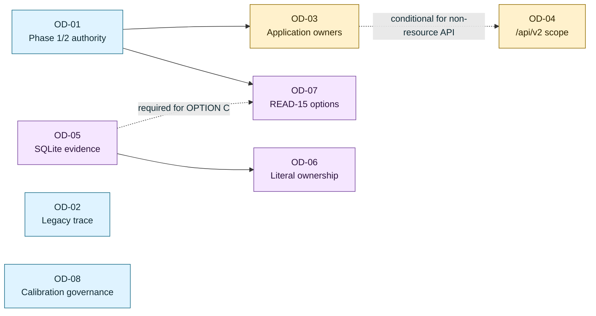

# Phase 12.17.3A — Decision dependency graph

## Graph

Solid arrows are strict sequencing dependencies for the recommended path. Dashed arrows are option-dependent constraints.

## Dependency classes

| Decision | Class | Prerequisite | Blocking consequence |
|---|---|---|---|
| `OD-01` | Independent root | None | Blocks authoritative completion planning for `OD-03` and `OD-07` |
| `OD-02` | Independent root | None | Does not block technical sequencing, but blocks complete governance closure |
| `OD-03` | Dependent | `OD-01` | Blocks lifecycle API option in `OD-04` |
| `OD-04` | Dependent/conditional | `OD-03` for non-resource options; Resource-only A already has an Application owner | Blocks `/api/v2` design scope |
| `OD-05` | Independent root | Exact authorized external evidence or explicit gap acceptance | Blocks data-model closure |
| `OD-06` | Dependent | `OD-05` | Blocks safe vocabulary/data-model alignment |
| `OD-07` | Dependent | `OD-01`; `OD-05` only for implementation option C | Blocks final READ-15 scope disposition |
| `OD-08` | Independent root | None | Blocks durable calibration policy rationalization |

## Counts

- Independent roots: `4`.
- Dependent decisions: `4`.
- Strict recommended-path edges: `OD-01 → OD-03`, `OD-01 → OD-07`, `OD-05 → OD-06`.
- Conditional edges: `OD-03 → OD-04`, `OD-05 → OD-07`.
- Unresolved nodes blocking the 12.17.4 gate: `8`.

## Safe evaluation order

1. Decide the independent roots `OD-01`, `OD-02`, `OD-05`, `OD-08`.
2. Evaluate `OD-03` and `OD-06` with those outcomes.
3. Evaluate `OD-07`; bind schema evidence only if implementation is chosen.
4. Evaluate `OD-04` against the selected Application scope.
5. Verify eight explicit attestations before changing readiness.

`DEFER` is a valid owner choice, but it remains unresolved for readiness unless the owner explicitly declares that a deferred subject is outside the scope of 12.17.4. No such declaration exists in this package.
